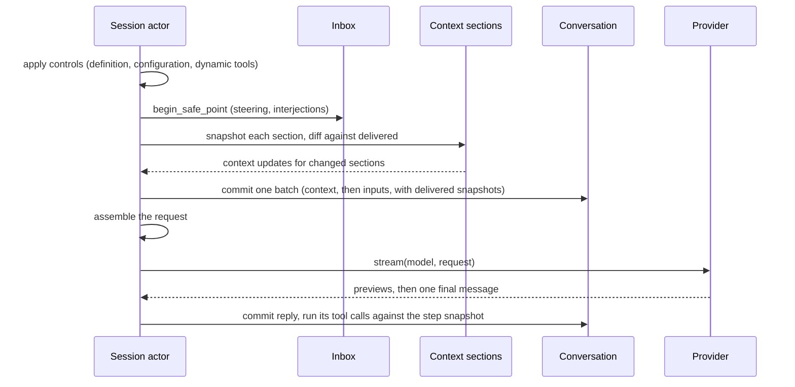

# Agent architecture: who owns which state

This describes the provider-independent agent stack: `language-model`, the
provider crates, `tool-runtime`, `agent-input`, and `agent-runtime`,
re-exported together by the `agent` crate. It says why each piece of state
lives where it does. The crates' READMEs say how to use them, and each
module's `//!` comment says what it owns.

The goal is an agent that is easy to extend without making it unclear where
state lives. Every piece of state has one owner, one lifetime, and one way to
change it. Extensions add data at defined points; they don't take over the loop.

## Principles

1. **One owner per piece of state.** Other layers get read-only snapshots, or
   send the owner a request. The session actor is the only thing that mutates a
   conversation.
2. **Lifetime decides the layer.** State belongs to the shortest-lived layer that
   contains all of its uses: provider connection, agent definition,
   conversation, run, step, tool call.
3. **The prefix is the session's tools, then the definition.** Providers cache a
   request's prefix (tools, then instructions, then messages), and a change
   invalidates everything after it. The tools registered when the session is
   built are fixed for its life. The rest of the prefix that can change (model,
   instructions, thinking, provider options) lives in the definition, which a
   new definition replaces whole. Everything else is configuration, or reaches
   the model as appended messages, and never invalidates the cache.
4. **Providers consume plain data.** A `CompletionRequest` is a flat struct built
   fresh for each step. It is never stored as agent state or mutated once built.
5. **The shared vocabulary carries only what the runtime acts on.** Model
   metadata and request fields exist in `language-model` only when code above
   the provider behaves differently because of them. Provider mechanics stay
   inside the adapter, or on its concrete client.
6. **Provenance is not authority.** Every model-visible entry records where it
   came from. Whether that source may do something is checked once, when its
   request is admitted, by the host's policy.
7. **Every change is a request; every result is an event.** Prompts, stops,
   compaction, definition and configuration changes, dynamic tool changes, and
   approval answers all arrive as requests with a source. The session reports
   everything that happens through ordered events.
8. **Extensions contribute data at chokepoints.** Tools, context sections, and
   tool sources receive data-only inputs and return data. Services they act
   through are injected when they are installed. They never own loop control.
9. **What the model has been told is conversation state.** Context updates are
   diffs against what was delivered, recorded with the messages that delivered
   it.

## Layers at a glance

| Layer | Owns | Lifetime | Changed by | Effect on the cache |
| --- | --- | --- | --- | --- |
| Provider | Connection, credentials, model discovery | Process | Host configuration | None |
| Definition | Model, instructions, thinking, provider options | Shared across conversations | `ReplaceDefinition`, whole | Invalidates it |
| Base tools | The tools registered when the session is built, in registration order | One session | Nothing; a new session | Never changes it |
| Configuration | Permissions, sampling controls, run limits, compaction policy | One conversation, seeded from shareable defaults | `Configure` requests | None |
| Conversation | Entries with provenance, compactions, delivered context, dynamic tools, inbox | One conversation | Requests, model replies, tool results | Appends only, except compaction |
| Run | Triggering origin, step count, run grants, cancellation | First input until finish | Inbox lifecycle, stop, interrupt | None |
| Step | Assembled request, definition revision, tool snapshot | One sample and its tool calls | Nothing; it is immutable | Defines the request |
| Tool call | Call ID, typed arguments, grant, cancellation, progress | One call | Authorization, then execution | None |

## Infrastructure

### Providers

A provider converts a `CompletionRequest` into its wire format, runs it, and
streams provider-neutral events back. It holds no conversation, agent, or tool
state, so one connection serves every agent that uses it. The persisted schema
is the shared message envelope, never a provider's format.

Two kinds of information are easy to blur:

- **Model metadata** is a fact about one model as this connection serves it,
  which the runtime acts on: context window (compaction triggers), maximum
  output tokens, image input, tool calling, thinking levels. These are typed
  fields on `LanguageModel`, from discovery or configuration. Each is an
  `Option`, so unknown stays apart from unsupported. They are scoped to the
  connection: the same weights served by Ollama and by vLLM can report
  different context windows.
- **Provider behavior** is how a protocol expresses things: where the system
  prompt goes, which roles exist, cache mechanics, finish-reason strings,
  native tool search. It stays inside the adapter, with no shared capability
  struct, because the request states intent and each adapter maps it.

The runtime acts on `image_input` when it samples: a model known not to accept
images (`Some(false)`) is sent a text note in place of each image, in user
content and tool results alike, while the conversation keeps the images for a
later model that accepts them. Unknown support sends them as they are.

How intent reaches each adapter:

- **Instructions have their own field**, `CompletionRequest.instructions`, so a
  system message in the middle of a conversation can't be expressed. Adapters
  put it where their protocol wants it.
- **The runtime produces only `User`, `Assistant`, and `Tool` messages.**
  Anthropic and native Ollama reject `Developer`, so context notes render as
  marked user content everywhere. `Role::Developer` and `Role::System` stay in
  the frozen v1 schema, but the conversation rejects them.
- **Cache intent, not mechanics.** `cache` marks where the stable prefix ends;
  Anthropic turns the points into `cache_control`, and providers that cache
  automatically ignore them.
- **Normalized finish reasons.** The runtime never matches a provider's own
  strings.
- **Several calls per reply** are always accepted, so it is not metadata.

Provider-specific optimizations, such as native tool search, go through concrete
clients' native requests (`stream_native`), not shared capabilities. A shared
capability is worth adding only when the runtime gets a second code path that
uses it. Retries, model fallback, and rate-limit backoff are runtime policies
that call the provider again; they are not hidden inside `stream`, and are not
built yet.

### Agent definition

The definition is the part of the prompt prefix that can change within a session,
at the cost of the cache. It is plain data, cloned and shared by many
conversations: the model (a different model has no cache to share), the
instructions, thinking (Anthropic invalidates cached messages when it changes,
and chat templates render thinking flags into the prompt), and provider options
(which can change the prompt, or reload the model, like Ollama's `num_ctx`).

It holds a `LanguageModel`, not a connection. The host supplies the
`Arc<dyn LanguageModelProvider>` when it builds the session, and a new one only
if a replacement definition uses a different provider.

A definition is never patched. `ReplaceDefinition` swaps it whole and
increments the `DefinitionRevision`; a step already running keeps the definition
it started with, and each model reply records the revision it was produced
under. The `model` context section tells the model the model changed. Every
change is a cache miss, so making small changes cheap would gain nothing.

What stays out of the definition:

- **Tools.** They come first in the prefix and are fixed for a session's life,
  offered in registration order after `search_tools` and `call_tool` (unless the
  session is built `without_dynamic_tools`). Tools are named once, where
  registered, and the schemas sent are those the implementations produce.
  Changing them takes a new session; tools that come and go are
  [dynamic tools](#dynamic-tool-discovery).
- **Anything that doesn't change the prompt**, which is
  [configuration](#configuration). A host can raise the output cap for one run
  without invalidating the cache.
- **Implementations and services**: tool implementations, tool sources such as
  MCP servers, approval UIs, storage, and observers are bound when the host
  builds a session.
- **Facts about one conversation**, such as project folders or the permission
  mode. These are [context sections](#request-state). In the instructions they
  would give every conversation its own prefix.

### Requests

The session is driven only by requests. A request has a source and a kind, and
inputs carry their own `InputId`. The source is host-defined: a participant, a
schedule, a webhook, a parent agent, or an extension. It travels with
everything the request produces: inbox entries, conversation entries, the run it
starts, and the authorization of every tool call in that run.

- **Inputs** are model-visible and go through `agent_input::Inbox`, which owns
  the delivery semantics (queue, steer, interject, interrupt; see its README).
- **Controls** (stop, resume, compact, shutdown, replace definition, configure,
  dynamic tools, approval answers) change state immediately or at the next step
  boundary and carry no model-visible payload. If a change matters to the
  model, the next step's context sections render it.

A definition is replaced whole, but configuration changes one field at a time.
Several sources change configuration independently, such as a participant
switching the permission mode while a scheduler adjusts limits; sending whole
values would let whichever arrives last silently undo the other. Definition
changes are rare and come from one place, so they have no such race.

The input payload is an application type, not a prerendered `Message`.
Notifications, webhooks, scheduled prompts, and subagent messages keep their
typed data until the session commits them, then render as user content, so a
source can't make its text privileged. `inputs_committed` lets the host update
state that later tool calls rely on without racing the event stream.

The host checks authority in `admit`, using the source, before the session acts
on a request. For example, only the thread's host may resolve an approval, and
text written by a subagent's model may never interrupt. The inbox and session
assume whatever reaches them was admitted.

The host is also where tools get their context: a tool whose `Context` is `T`
registers when the host implements `AsRef<T>`. `BasicHost` covers single-user
programs.

## Conversation state

### The conversation

`Conversation` owns the accepted transcript: complete messages, their tool-call
correlation, and compaction records. Every entry records its `Origin` (an input
and its source, a model reply and its definition revision, a tool result, or
context notes), so "who sent message 12" can be answered after a restore, not
only from a live event. It also records the last snapshot of each context section
the model received, and the entry that delivered it.

Instructions are not in the conversation. The definition owns them, and the
conversation rejects system and developer messages.

Compaction is a context replacement, never a deletion. It can use each entry's
origin: a user's input is an anchor worth keeping in the summary, while a
context note can be dropped because its section renders again after it.

### Configuration

Configuration is session state that doesn't change the prompt prefix:
permissions (the host's `Permissions` value), sampling controls, steps per run,
and the compaction policy. The run's grants (from approvals allowed for the rest
of a run) belong to the run. The host seeds the configuration when it builds the
session; `Configure` requests change one field at a time, applying to calls not
yet authorized and to the next request. A change the model should know about,
such as the permission mode, reaches it through the `tool_policy` section.

### Tool execution

A tool's definition belongs to the tool (`tool-runtime`), which tools a conversation offers belongs to the session, and whether one call may run belongs to configuration plus the run's grants and approvals.

- **Context is a type parameter, not a type map.** Each tool declares the
  services it needs as `type Context`, and a registry erases tools against a
  host context `C`. Registration requires `C: AsRef<T::Context>`, so the
  compiler checks a tool's dependencies when it is registered instead of a
  lookup failing on each call. The runtime's own per-call data (`ToolCall`) is
  separate from the tool's context. The run's origin is not in it:
  authorization uses the origin (to treat a scheduled run differently from a
  participant's prompt), and keeping it out leaves `Tool` free of the host's
  source type. Progress travels in the tool's stream, not a separate sink.
- **Per-call access.** `ToolCapabilities.is_read_only` describes a whole tool,
  but permission depends on arguments: a shell command that only reads needs
  less than one that uses the network. A call is first *prepared*: arguments are
  decoded and `Tool::access` computes what it needs, without running anything.
  `AgentHost::authorize` decides on that value with the permissions, the run's
  grants, and the run's origin. The prepared call keeps the value and hands it
  to the tool, so the tool runs with exactly what was allowed.
- **Approvals are requests.** When `authorize` returns `Ask`, the session emits
  `ApprovalRequested` and parks the call. The answer arrives as `ResolveApproval`
  from a source the host admitted: `AllowOnce`, `AllowForRun` (adds a grant that
  the run's later calls are authorized with), or `Deny`. Stop and shutdown settle
  parked calls like any other unfinished call, and a late answer finds nothing
  to resolve. A pending future hidden inside authorization would make who
  answered invisible to the session and its log.
- **Scheduling.** The executor runs one call at a time, which is a safe default.
  When parallel execution comes it belongs here and nowhere else: calls declared
  parallel-safe may overlap within `max_concurrency`, results are always
  committed in the order of the reply's calls so the transcript doesn't depend on
  timing, and cancellation and `yield_wait` stay cooperative and per call.

### Dynamic tool discovery

Dynamic tools work through two built-in tools offered before the base tools,
`search_tools` and `call_tool`. They work with every provider, and appending
results to the conversation never changes the request's prefix. The session owns
the dynamic tools, a registry separate from the base tools, changed only by
`DynamicTools` requests.

- **They are offered by default, even while the catalog is empty.** Adding them
  when the first dynamic tool appeared would change `tools` and invalidate the
  cache. A session built `without_dynamic_tools` leaves them out, has no dynamic
  tools, and rejects `DynamicTools` requests.
- **`search_tools`** is the runtime's own read-only built-in, so it needs no
  authorization. It returns matching names, descriptions, and full schemas as an
  ordinary tool result.
- **`call_tool` is not a second execution path.** The model's call stays in the
  transcript as emitted, and its result is correlated to it, but before
  authorization the executor resolves it to the inner tool and arguments.
  Requirements, approval, events, typed output, and UI cards all see the real
  tool. A wrapper whose inner calls skip the outer path (as Grok Build's
  `use_tool` does) runs reminders and persistence for the wrapper instead of the
  tool it called. `call_tool` rejects base tools with a corrective error, so each
  tool is called in exactly one way.
- **Removal.** Each step takes a snapshot of the dynamic tools, and the calls in
  that step's reply run against it. A later call to a removed tool gets a
  `NotFound` result.
- **Telling the model.** The `dynamic_tools` section reports tools added (names
  and descriptions) and removed since the model last heard. After a compaction
  summarizes that note, it renders the whole list again. Schemas are not
  repeated; the model searches again for what it needs.

## Request state

Each step gathers information from several subsystems, then builds one flat
`CompletionRequest`. This assembly is the only place the subsystems meet the
provider, and the only place model-visible context is generated. Nothing else
feeds the request: a subsystem that needs to influence the model does so through
a context section, a tool, the configuration, or the definition.

A context section is a typed view of some state that knows how to tell the model
about a change. Its snapshot holds only what is needed to decide what to say
next, and rendering takes the previously delivered snapshot (`None` when the
model has not seen the section, at the start or after a compaction) and the
current one. The built-in sections are `tool_policy`, `dynamic_tools`, and
`model`; hosts add their own for the environment, collaborators present, the
time, or reminders.

The rules that keep this cache-friendly:

- **Context updates are committed, never ephemeral.** A note injected into one
  request and dropped from the next changes the next request's prefix. Committing
  it also makes it visible in the transcript and the log.
- **Updates happen only at safe points**, where steering happens: every call
  settled, before sampling. Updates and steering commit as one batch, with the
  context entry before the inputs.
- **The diff compares with what was delivered.** A compaction that summarizes the
  delivering entry makes the section render in full again. Delivered snapshots
  are not persisted yet, so a resumed session renders every section again, which
  repeats information but never loses it.
- **The runtime owns wrapping and placement.** A section returns text; the runtime
  wraps it in its own `<section_id>` tags as a separate text block, combines a
  step's notes into one user entry, and records `Origin::Context`. Notes are
  identified by that origin, never by matching their text.

## The Cowork app

The host of a thread runs one `AgentSession` for it, created with the thread's
first run and kept for its later ones, so what the model was told (such as the
environment note) carries over between runs. Only the host runs the agent;
collaborators see what the session commits.

Before any model content arrives, the timeline shows “Working on it…”.
“Thinking…” is reserved for streamed reasoning; answer text and tool calls
render as their own content. The “Working for…” header appears at the first
model content (including a streamed tool call). Its timer and final “Worked
for…” duration exclude the initial wait, but include the rest of the run,
including tools and later requests. The host publishes this start time and
saves it with the run, so collaborators, late joiners and reopened chats use
the same timing. Request durations used for usage statistics are unchanged;
older saved runs without a recorded content start retain their full duration.

| Concept | In Cowork |
| --- | --- |
| `AgentHost` | `CoworkHost` ([tool_approval.rs](../crates/cowork/src/tool_approval.rs)): sources are the participant or schedule that started a run, inputs are a submission's content, and each call declares its sandbox needs or web access |
| Tool contexts | The thread's sandbox (commands and files), the run's comments (`respond_to_comment`), and the host's shared web configuration (Firecrawl tools) |
| Authorization | [Permissions](permissions.md) covers project modes, host-only approvals, and scheduled runs |
| Tools | The tools registered in `generation.rs`'s `registry`, in that order, without dynamic tools |
| Definition | The selected model, the system prompt, and the thinking and options the model's provider takes (`ModelProvider::request_parameters` in `providers.rs`: Ollama's `num_ctx`, Anthropic's `max_tokens` and thinking style, OpenAI's `reasoning_effort`). A change of provider or API key hands the session a new connection with the definition. A model change replaces it before the next run |
| Context sections | `environment`: the project's folders and mode and the scratch folder, sent whenever they changed |
| Inputs | Cowork keeps its own queue of pending submissions, which collaborators see and cancel, and hands the session one input at a time when no run is going; steering submissions go to the session as `Delivery::Steer` |
| Compaction | Requested when a request reports the context past the user's threshold, or when a run starts on a full context |
| Events | The host projects each run's events onto `RunEvent`s (previews, committed entries, usage, compactions), which every participant folds into a replica of the conversation; see [collaboration.md](collaboration.md) |
| Saved chats | SQLite ([sqlite-storage.md](sqlite-storage.md)). Cowork does not use `agent-runtime`'s JSONL log; it reuses only the `persistence::record` types (`StoredEntry`, `StoredCompaction`) as the stored and wire form of entries |

`request_permissions` grants what it asked for when it runs, into the sandbox's
run grants, which later commands of the run get; the runtime's `AllowForRun`
grants are not used.

## Decisions

- **Tool contexts and access** are associated types checked at registration, not
  a type map, which hides what a tool depends on.
- **Dynamic tools** are the portable `search_tools` and `call_tool` pair only.
  Provider-native tool search can come later through concrete clients.
- **The request shape** is flat, with its own `instructions` field.
- **Context notes** are one `<section_id>`-tagged text block per section, in one
  user entry per step.
- **Persistence.** The message schema stays at v1. The runtime does not persist
  queued inputs or pending approvals. After a crash, its JSONL log settles calls
  it never saw start as not run; calls that may have started need explicit
  recovery, and nothing is re-executed.

Follow-ups, none needed for the current design to hold:

- Persist delivered context snapshots, so a resumed session doesn't repeat
  context notes.
- Bound the `dynamic_tools` note for large catalogs, and rank search results.
- Run parallel-safe calls concurrently, committing results in call order.
- Provider-native tool search, through concrete clients.
- Move Cowork's pending submissions into the session's inbox, and its approvals
  onto `AllowForRun`.
