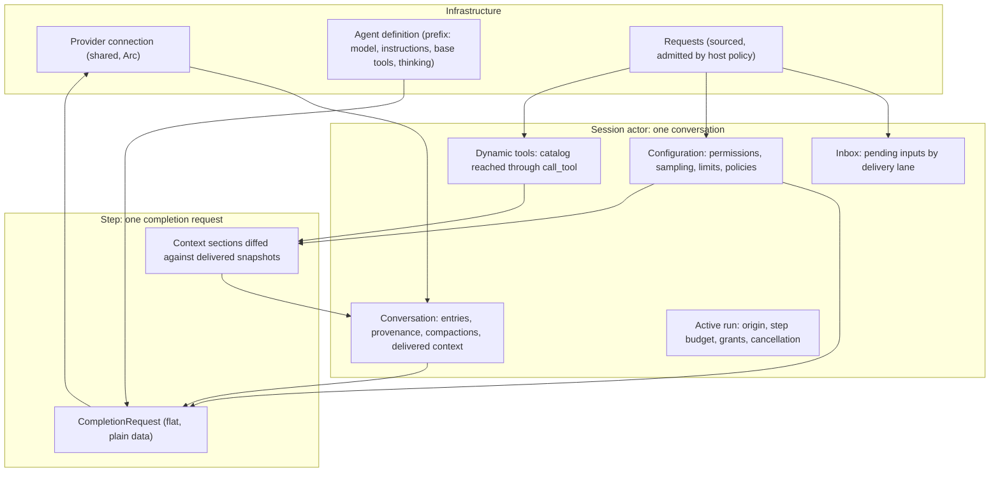
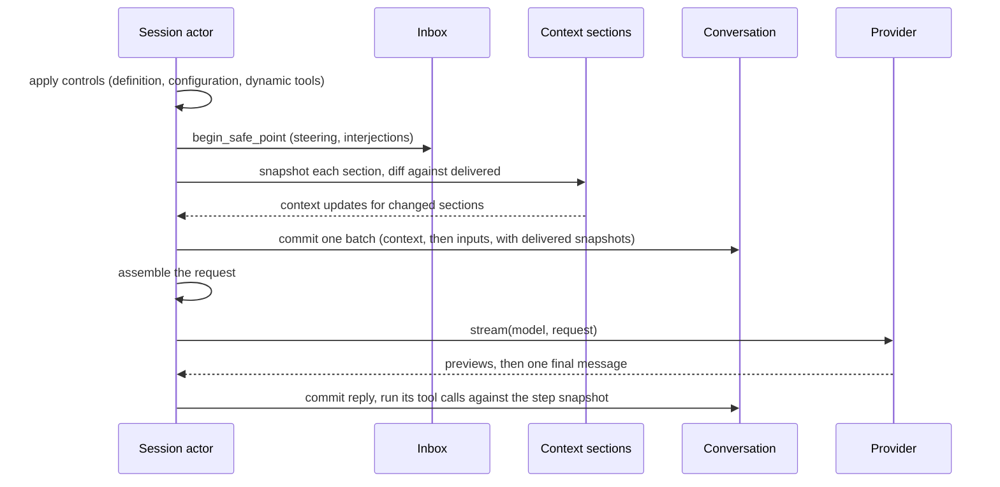

# Agent architecture: who owns which state

This is the architecture of the provider-independent agent stack. That stack is
`language-model`, the provider crates, `tool-runtime`, `agent-input`, and
`agent-runtime`, assembled by `language-models` and exercised by its examples.
This document introduces the stack's concepts and why each piece of state lives
where it does; the crates' READMEs describe their APIs. The design was proposed
here first and is now implemented; [Implementation](#implementation) maps it to
the code. The Cowork app still runs on Rig; nothing here describes the app.
Where the app is mentioned, it is only an example of a future consumer.

The goal is an agent that is easy to extend without making it unclear where
state lives. Every piece of state has one owner, one lifetime, and one way to
change it. Extensions add data at defined points; they don't take over the loop.

- [Principles](#principles)
- [Layers at a glance](#layers-at-a-glance)
- [Infrastructure](#infrastructure): providers, agent definitions, requests
- [Conversation state](#conversation-state): the conversation, configuration, tool execution, dynamic tools
- [Request state](#request-state): assembling each completion request
- [Comparison with other harnesses](#comparison-with-other-harnesses)
- [Implementation](#implementation)
- [Decisions](#decisions)

## Principles

1. **One owner per piece of state.** Each piece of state is owned by exactly one
   layer. Other layers get read-only snapshots, or send that owner a request.
   The session actor is the only thing that mutates a conversation.
2. **Lifetime decides the layer.** State belongs to the shortest-lived layer that
   contains all of its uses. In order: provider connection, then agent
   definition, conversation, run, step, and tool call.
3. **The definition is what invalidates the prompt cache.** Providers cache a
   request's prefix: tools, then instructions, then messages. A change
   invalidates everything after it. Whatever changes the prompt prefix (the
   model, instructions, base tools, thinking) belongs in the definition. A new
   definition replaces the old one whole. Everything else can change during a
   conversation without invalidating the cache. It is configuration, or it
   reaches the model as appended messages.
4. **Providers consume plain data.** A `CompletionRequest` is a flat struct
   built fresh for each step from the layers above it. It is never stored as
   agent state and never mutated once built.
5. **The shared vocabulary carries only what the runtime acts on.** Model
   metadata and request fields exist in `language-model` only when code above
   the provider behaves differently because of them. Provider-specific mechanics
   stay inside the adapter, or on its concrete client.
6. **Provenance is not authority.** Every model-visible entry records where it
   came from. Whether that source was allowed to do something is checked once,
   when its request is admitted, by the host's policy.
7. **Every change is a request; every result is an event.** User prompts,
   webhooks, stops, compaction, definition and configuration changes, dynamic
   tool changes, and approval answers all arrive as requests with a source. The
   session reports everything that happens through ordered events.
8. **Extensions contribute data at chokepoints.** Tools, context sections, and
   tool sources receive data-only inputs and return data. Services they act
   through are injected when they are installed. They never own loop control.
9. **What the model has been told is conversation state.** Context updates are
   diffs against what was delivered, and that is recorded with the messages that
   delivered it.

## Layers at a glance



| Layer | Owns | Lifetime | Changed by | Effect on the cache |
| --- | --- | --- | --- | --- |
| Provider | Connection, credentials, model discovery | Process | Host configuration | None |
| Definition | Model, instructions, base tools, thinking, provider options | Shared across conversations | `ReplaceDefinition`, whole | Invalidates it |
| Configuration | Permissions, sampling controls, run limits, compaction and input policies | One conversation, seeded from shareable defaults | `Configure` requests | None |
| Conversation | Entries with provenance, compactions, delivered context, dynamic tools, inbox | One conversation | Requests, model replies, tool results | Appends only, except compaction |
| Run | Triggering origin, step count, run grants, cancellation | First input until finish | Inbox lifecycle, stop, interrupt | None |
| Step | Assembled request, definition revision, tool snapshot | One sample and its tool calls | Nothing; it is immutable | Defines the request |
| Tool call | Call ID, typed arguments, grant, cancellation, progress | One call | Authorization, then execution | None |

## Infrastructure

### LLM provider

A provider converts a `CompletionRequest` into its wire format, runs the
request, and streams provider-neutral events back. It holds no conversation,
agent, or tool state, so one connection serves every agent that uses it.

This layer exists already and is mostly right. `LanguageModelProvider::stream`
takes `&LanguageModel` and an owned `CompletionRequest`. Each provider's wire
types and conversions live in `crates/providers/*/types`. The persisted schema
is the shared message envelope, not any provider's format.

**Model metadata versus provider behavior.** Two kinds of information are easy
to blur together:

| Kind | Examples | Where it lives |
| --- | --- | --- |
| Model metadata: facts about one model as this connection serves it, which the runtime acts on | Context window (compaction triggers), maximum output tokens, image input, tool calling, thinking levels | Typed fields on `LanguageModel`, from discovery or configuration. Each is `Option`, so unknown stays apart from unsupported. |
| Provider behavior: how a protocol expresses things | System prompt placement, which roles exist, prompt-cache mechanics and breakpoint limits, finish-reason strings, parallel-call request flags, native tool search | Inside the adapter. Not in the shared vocabulary. |

Model metadata is scoped to the connection, as `LanguageModel` already is. The
same weights served by native Ollama and by vLLM can report different context
windows. Replacing `capabilities: Option<Vec<String>>` with typed fields:

```rust
pub struct LanguageModel {
    pub id: String,
    pub name: Option<String>,
    pub context_window: Option<u64>,
    pub max_output_tokens: Option<u64>,
    pub tool_calls: Option<bool>,
    pub image_input: Option<bool>,
    pub thinking: ThinkingCapabilities,
    pub metadata: JsonObject,
}
```

Provider behavior gets no shared capability struct. The runtime never needs to
branch on it, because the request expresses intent and each adapter maps that
intent:

- **Instructions get their own field.** `CompletionRequest.instructions` replaces
  the leading `System` message. Anthropic's adapter currently has to reject
  system messages after the first conversation message
  ([conversion.rs:122](../crates/providers/anthropic/types/src/conversion.rs#L122)).
  With a separate field, a system message in the middle of a conversation can't
  be expressed at all. Chat-completions and Ollama prepend the field as a system
  message.
- **The runtime produces only `User`, `Assistant`, and `Tool` messages.**
  Anthropic and native Ollama both reject `Developer`
  ([anthropic](../crates/providers/anthropic/types/src/conversion.rs#L141),
  [ollama](../crates/providers/ollama/types/src/conversion.rs#L224)). So context
  notes render as marked user content everywhere. `Role::Developer` and
  `Role::System` stay in the frozen v1 schema, but the conversation rejects
  them.
- **Cache intent, not cache mechanics.** `cache: Vec<CachePoint>` marks where the
  stable prefix ends: after the tools, after the instructions, or after a
  message. Anthropic turns these points into `cache_control` and keeps as many
  as it allows. Providers that cache automatically ignore them.
- **Normalized finish reasons.** The adapter reports
  `FinishReason::{Stop, ToolCalls, Length, ContentFilter, Refusal, Other(String)}`
  in `GenerationMetadata`, keeping an unrecognized reason's wire string in
  `Other`. The runtime used to match every provider's own strings itself.
- **Several calls per reply.** The runtime always accepts several tool calls in
  one reply. Whether a model emits them changes nothing, so it is not metadata.

Optimizations that depend on a provider, such as native tool search, come later
through concrete clients' native requests, the existing `stream_native` escape
hatch. They do not get shared capabilities. A provider-level capability is worth
adding only when the runtime gets a second code path that uses it.

Retries, model fallback, and rate-limit backoff are runtime policies that call
the provider again. They are not hidden inside `stream`.

### Agent definition

The definition is the part of an agent whose change invalidates the prompt
cache. It is plain data, which can be cloned, serialized, and shared by many
conversations.

| Field | Why it changes the prompt |
| --- | --- |
| `model: LanguageModel` | A different model has no cache to share |
| `instructions` | Second in the prefix, after the tools |
| `tools: Vec<String>` | First in the prefix. Base tool names. `search_tools` and `call_tool` are included by default for [dynamic tools](#dynamic-tool-discovery). Implementations come from the host's registry. |
| `thinking` | Anthropic invalidates cached messages when thinking settings change, and chat templates render thinking flags into the prompt |
| `options` | Provider options can change the prompt, or reload the model (Ollama's `num_ctx`) |

The definition contains a `LanguageModel` (plain data), not a connection. The
host supplies the `Arc<dyn LanguageModelProvider>` when it builds the session,
and supplies a new one only if a replacement definition uses a different
provider.

A definition is never patched. `ReplaceDefinition` swaps it whole and
increments the conversation's `DefinitionRevision`; a step already running
keeps the definition and tools it started with. Each model reply records the
revision it was produced under. The `model` context section tells the model
when the model changed.
Replacing the whole definition keeps the rule simple. Every change is a cache
miss, so making small changes cheap gains nothing.

What stays out of the definition:

- **Anything that doesn't change the prompt.** That is
  [configuration](#configuration): permissions, `max_output_tokens`,
  `temperature`, `top_p`, `stop`, `seed`, run limits, and the compaction
  policy. A host can raise the output cap for one run without invalidating
  the cache.
- **Implementations and services.** Tool implementations, tool sources such as
  MCP servers, approval UIs, storage, and observers are bound when the host
  builds a session.
- **Facts about one conversation**, such as project folders or the current
  permission mode. These are [context sections](#request-state). In the
  instructions, they would give every conversation its own prefix, and one
  agent's conversations couldn't share a cached prefix.

### Generation requests

The session is driven only by requests. A request has a source and a kind;
inputs carry their own `InputId`. The source is host-defined: a participant, a
schedule, a webhook, a
parent agent, or an extension. It travels with everything the request produces:
inbox entries, conversation entries, the run it starts, and the authorization
request for every tool call in that run.

```rust
pub struct Request<H: AgentHost> {
    pub source: H::Source,
    pub kind: RequestKind<H>,
}

pub enum RequestKind<H: AgentHost> {
    // Model-visible work, through the inbox's lanes.
    Input { id: InputId, payload: H::Input, delivery: Delivery, policy: Policy },
    EditInput { id: InputId, payload: H::Input },
    RemoveInput { id: InputId },
    RedirectInput { id: InputId, delivery: Delivery },
    MoveInput { id: InputId, before: Option<InputId> },
    SourceClosed,

    // Run lifecycle.
    Stop { run: RunId },
    Resume,
    Compact,
    Shutdown,

    // State. Model-relevant changes reach the model through context sections.
    ReplaceDefinition { definition: AgentDefinition, provider: Option<Arc<dyn LanguageModelProvider>> },
    Configure(ConfigurationChange<H::Permissions>),
    DynamicTools(DynamicToolChange<H>),

    // Answers to questions the session asked.
    ResolveApproval { call: ToolCallId, decision: ApprovalDecision },
}
```

There are two kinds of request:

- **Inputs** are model-visible and go through `agent_input::Inbox`, which already
  implements the delivery semantics well. `Queue` starts a later run. `Steer`
  joins the active run at the next safe point. `Interject` steers and also wakes
  a cooperative wait. `Interrupt` cancels the run and goes first in line.
  Reservations keep ownership of an input until it is committed.
- **Controls** change state immediately or at the next step boundary, and carry
  no model-visible payload. If a control changes something the model should
  know, the next step's context sections render the change.

A definition is replaced whole, but configuration changes one field at a time.
Several sources change configuration independently: a participant switches
the permission mode while a scheduler adjusts limits. Sending the whole value
would make whichever change arrives last silently undo the other. Definition
changes are rare and come from one place, so replacing the whole definition
has no such race.

The payload is an application type, not a prerendered `Message`. Notifications,
webhooks, scheduled prompts, and messages from subagents keep their typed data
until the session commits them. Then they render to content:

```rust
pub trait AgentHost: Send + Sync + Sized + 'static {
    /// Who sent a request. Recorded on conversation entries and runs.
    type Source: Clone + PartialEq + Debug + Send + Sync + 'static;
    /// Model-visible input, kept typed until it is committed.
    type Input: RenderInput + Clone + Debug + Send + Sync + 'static;
    /// What one tool call needs. Each tool's own access converts into it.
    type Access: Clone + Debug + Send + Sync + 'static;
    /// The live permission state, part of the configuration.
    type Permissions: Clone + Debug + Send + Sync + 'static;

    fn admit(&self, request: &Request<Self>) -> Result<(), String> { Ok(()) }
    fn authorize(&self, call: &CallAuthorization<'_, Self>) -> Decision;
    fn describe_permissions(&self, permissions: &Self::Permissions, tools: &[ToolDescriptor])
        -> Option<String> { None }
}

pub trait RenderInput {
    /// Rendered when committed, always as user content, so a source can't
    /// make its text privileged.
    fn render(&self) -> Vec<Content>;
}
```

The host checks authority in `admit`, using the source, before the session
acts on a request. For example, only the thread's host may resolve an approval,
and text written by a subagent's model may never interrupt. Grok Build models
this as `InputAuthority::{HumanIntent, ModelAuthoredUntrusted, RuntimeControl}`
on each input. The inbox and session assume whatever reaches them was admitted.

The host is also where tools get their context: a tool whose `Context` is `T`
can be registered when the host implements `Provides<T>`. `BasicHost` covers
single-user programs: string sources and inputs, tools that need no context,
and permissions by tool name.

## Conversation state

### The conversation

`Conversation` owns the accepted transcript: complete messages, their tool-call
correlation, and compaction records. That already works. Two things move into it:

- **Provenance per entry.** Every entry records where it came from, so questions
  such as "who sent message 12" can still be answered after a restore, not only
  from a live event:

  ```rust
  pub struct Entry<S> { pub message: Message, pub origin: Origin<S> }

  pub enum Origin<S> {
      Input { id: InputId, source: S },
      Model { revision: DefinitionRevision },
      Tool, // the message names its call
      Context { sections: Vec<String> },
  }
  ```

- **Delivered context.** The last snapshot of each context section the model
  received, and the entry that delivered it.

The instructions left the conversation. The definition owns them, and
`CompletionRequest.instructions` carries them; the conversation rejects system
and developer messages. The system prompt used to be message 0, so a resumed
session had to check that the saved prefix matched, and compaction had to skip
leading system and developer messages. Both checks are gone.

Compaction stays a context replacement, never a deletion. It can use each
entry's origin, as Grok Build's `CompactionClass` does. A user's input is an
anchor worth keeping in the summary. A context note can be dropped, because its
section renders again after the summary.

### Configuration

Configuration is session state that doesn't change the prompt prefix. It holds:

- permissions: the host's `Permissions` value (a mode, per-tool overrides);
- sampling controls: `max_output_tokens`, `temperature`, `top_p`, `stop`,
  `seed`;
- run limits: steps per run, and later token budgets;
- the compaction policy.

The run's grants (from approvals allowed for the rest of a run) belong to the
run, not the configuration. The host seeds the configuration from a reusable
value when it builds the session. `Configure` requests change it one field at a
time; a change applies to calls not yet authorized and to the next request. A
change the model should know about, such as the permission mode, reaches it
through the tool-policy context section.

When a request is assembled, the definition and configuration are checked
against each other. For example, Anthropic requires a thinking budget below
`max_tokens`. The adapter's validation already reports this.

### Tool execution

Tool state has three parts, each with a different owner:

| Concern | Owner | Lifetime |
| --- | --- | --- |
| What a tool is: name, schema, capabilities, implementation | The tool (`tool-runtime`) | Registration |
| Which tools this conversation offers | The definition (base tools) and dynamic tools (session) | Revision, conversation |
| Whether a particular call may run | Configuration (permissions), plus the run's grants and approvals | Conversation, run |

**The tool contract** (`tool-runtime`): typed `Args` with generated schemas,
typed outputs kept apart from their model-facing projection, progress streams,
and declared `ToolCapabilities`, plus:

- **`type Context` on the tool.** Each tool declares the services it needs. The
  runtime's own per-call data is a fixed `ToolCall` beside it:

  ```rust
  pub trait Tool: Send + Sync + 'static {
      type Args: DeserializeOwned + JsonSchema + Send + 'static;
      type Output: ToolOutput + Send + 'static;
      /// Host services this tool needs; `()` when it needs none.
      type Context: ?Sized + Send + Sync + 'static;
      /// What one call needs; `()` when calls differ only by tool.
      type Access: Clone + Default + Send + Sync + 'static;

      fn access(&self, args: &Self::Args, cx: &Self::Context) -> Self::Access;
      async fn run(&self, call: ToolCall<Self::Access>, cx: Arc<Self::Context>, args: Self::Args)
          -> Result<Self::Output, ToolError>;
  }

  /// Runtime-owned facts about one invocation.
  pub struct ToolCall<A> {
      pub id: ToolCallId,
      /// Exactly what authorization allowed.
      pub access: A,
      pub control: CallControl,
  }
  ```

  A registry holds tools with different context and access types, so it erases
  them against a host context `C` and host access `A`. Registering a tool
  requires that the host provides the tool's context and that its access
  converts:

  ```rust
  pub trait Provides<T: ?Sized> {
      fn provide(self: &Arc<Self>) -> Arc<T>;
  }
  impl<C: ?Sized> Provides<()> for C { /* ... */ }

  impl<C, A> ToolRegistry<C, A> {
      pub fn register<T: Tool>(&mut self, tool: T) -> Result<(), ToolError>
      where C: Provides<T::Context>, A: From<T::Access>;
  }
  ```

  In a session, `C` is the host itself and `A` is `H::Access`. The compiler
  checks a tool's dependencies when it is registered, rather than through a
  type-map lookup on each call. The context is an `Arc`, so streaming tools can
  move it into their `'static` stream. Progress travels in the tool's stream,
  not a separate sink. The run's origin is not in `ToolCall`: authorization is
  what uses it (to treat a scheduled run differently from a participant's
  prompt, for example), and keeping it out keeps `Tool` free of the host's
  source type.

- **Per-call access.** `ToolCapabilities.is_read_only` describes a whole tool,
  but permission usually depends on the arguments: a shell command that only
  reads needs less than one that uses the network. A call is first *prepared*:
  its arguments are decoded and `Tool::access` computes what it needs, without
  running anything. `AgentHost::authorize` decides on that value with the
  permissions, the run's grants, and the run's origin. The prepared call keeps
  the value and hands it to the tool, so the tool runs with exactly what was
  allowed.

- **Approvals are requests.** When `authorize` returns `Ask`, the session emits
  `ApprovalRequested { call, tool, access }` and parks the call. The answer
  arrives as `ResolveApproval` from a source the host admitted: `AllowOnce`,
  `AllowForRun` (adds a `Grant { tool, access }` the run's later calls are
  authorized with), or `Deny`. Stop and shutdown settle parked calls like any
  other unfinished call, and a late answer finds nothing to resolve. The old
  `Authorization::Pending` held an opaque future, so who answered was invisible
  to the session and its log.

**Scheduling.** The executor runs one call at a time, which is a safe default. Parallel execution belongs here and nowhere else. Calls declared
parallel-safe may overlap, within `max_concurrency`. Results are always
committed in the order of the reply's calls, so the transcript doesn't depend
on timing. Cancellation and `yield_wait` stay cooperative and per call.

### Dynamic tool discovery

Dynamic tools work through two tools in the definition: `search_tools` and
`call_tool`. These work with every provider, and appending results to the
conversation never changes the request's prefix. Provider-native tool search
can come later, as an optimization.

The session owns the dynamic tools, a registry separate from the host's base
tools, changed only by `DynamicTools` requests:

```rust
pub enum DynamicToolChange<H: AgentHost> {
    Add(Arc<dyn ToolDyn<H, H::Access>>),
    Remove(String),
}
```

- **Base tools and dynamic tools change differently.** Base tools are in the
  definition. Changing them means replacing the definition, which costs the
  cache. Dynamic tools change through `DynamicTools(DynamicToolChange)`
  requests, which only ever add to the conversation. `search_tools` and
  `call_tool` are in every definition by default, even while the catalog is
  empty. Adding them when the first dynamic tool appeared would change `tools`
  and invalidate the cache. A definition that leaves them out has no dynamic
  tools, and the session rejects `DynamicTools` requests for it.
- **Searching.** `search_tools` returns matching names, descriptions, and full
  schemas as an ordinary tool result. It is the runtime's own read-only
  built-in, so it needs no authorization. Matching is by query words in names
  and descriptions; ranking such as BM25 can come later.
- **Calling.** `call_tool { name, arguments }` reaches any tool in the catalog.
  It rejects base tools with a corrective error telling the model to call the
  tool directly, so each tool is called in exactly one way.
- **`call_tool` is not a second execution path.** The model's `call_tool` call
  stays in the transcript exactly as emitted, and its result is correlated to
  it. Before authorization, though, the executor resolves it to the inner tool
  and arguments. Requirements, approval, concurrency limits, events, typed
  output, and UI cards then all see the real tool. Grok Build's `use_tool` shows
  the alternative to avoid. Its inner call goes through `call_raw()`, outside
  the outer bridge's lock, so reminders and persistence run for `use_tool`
  instead of for the tool it called.
- **Removal.** Each step takes a snapshot of the dynamic tools, and the calls in
  that step's reply run against that snapshot. A later call to a removed tool
  gets a `NotFound` result.
- **Telling the model.** The `dynamic_tools` context section reports what
  changed since the model last heard: tools added (names and descriptions) and
  tools removed. After a compaction summarizes that note, the section renders
  the whole list again. Schemas are not repeated; a summary may have dropped
  earlier search results, and the model searches again for what it needs.

Possible later optimizations, each through a provider's concrete client:
provider-native tool search with deferred definitions, and adding discovered
tools to `tools` at a compaction, when the request changes anyway.

## Request state

Each step gathers information from several subsystems, then builds one flat
`CompletionRequest`. This assembly is the only place the subsystems meet the
provider, and the only place model-visible context is generated:



A context section is a typed view of some state, which knows how to tell the
model about a change:

```rust
pub trait ContextSection<H: AgentHost>: Send + Sync + 'static {
    /// Tag name and delivery key; must stay stable.
    const ID: &'static str;
    /// Only the data needed to decide what the model must be told next.
    type Snapshot: Serialize + DeserializeOwned + PartialEq;

    fn snapshot(&self, view: &SessionView<'_, H>) -> Self::Snapshot;

    /// `None` for `previous` means the model has not seen this section, either
    /// at the start or after a compaction, so render the full state. Return
    /// `None` when there is nothing to say.
    fn render(&self, previous: Option<&Self::Snapshot>, current: &Self::Snapshot)
        -> Option<String>;
}
```

The built-in sections are:

- **`tool_policy`.** The host's `describe_permissions`: which tools or access
  levels run without asking, and which need approval or are refused. Telling
  the model this lets it avoid triggering approvals it doesn't need.
- **`dynamic_tools`.** Dynamic tools added and removed.
- **`model`.** That the model changed after a `ReplaceDefinition`.

Hosts add their own, for example the environment (working folders, mode,
platform), collaborators present, the current time, or todo reminders. These
are the cases Grok Build's `TurnInputContributor` and post-tool `Reminder`s
handle.

The rules that keep this predictable and cache-friendly:

- **Context updates are committed, never ephemeral.** A note injected into one
  request and dropped from the next changes the next request's prefix, so it
  invalidates the cache. Committing it also makes it visible in the transcript
  and the log.
- **Updates happen only at safe points.** That is where steering happens: every
  call settled, before sampling. Updates and steering commit as one batch, with
  the context entry before the inputs.
- **The diff compares with what was delivered.** The conversation records each
  section's delivered snapshot with the position of the entry that delivered
  it. A compaction that summarizes that entry makes the section render in full
  again. Delivered snapshots are not persisted yet, so a resumed session
  renders every section again; that repeats information but never loses it.
  Codex's `matches_legacy_fragment` shows the cost of adding snapshot tracking
  to context that was written without it.
- **The runtime owns wrapping and placement.** A section returns text. As Codex
  does with its fragments, the runtime wraps each section's note in its own
  `<section_id>` tags as a separate text block, combines a step's notes into
  one user entry, and records `Origin::Context`. Notes are identified by that
  origin, never by matching their text.

The assembled request is flat and is never changed after assembly:

```rust
pub struct CompletionRequest {
    pub instructions: Option<String>,   // definition
    pub tools: Vec<ToolDefinition>,     // definition's base tools, including search_tools and call_tool
    pub messages: Vec<Message>,         // conversation.model_messages()
    pub thinking: Option<Thinking>,     // definition
    pub options: JsonObject,            // definition
    pub max_output_tokens: Option<u64>, // configuration (and temperature, top_p, stop, seed)
    pub cache: Vec<CachePoint>,         // after tools, after instructions, at the last entry
}
```

Nothing else feeds the request. A subsystem that needs to influence the model
does so through a context section, a tool, the configuration, or the
definition.

## Comparison with other harnesses

The two harnesses compared here are the Codex and Grok Build checkouts attached
to this thread.

The "Before" column is this stack before the rework.

| Concern | Before | Codex | Grok Build |
| --- | --- | --- | --- |
| Provider boundary | `LanguageModelProvider` taking a plain `CompletionRequest`; one crate per provider's wire types | `model-provider` plus `ModelInfo` flags, centred on OpenAI's Responses API | `xai-grok-sampling-types` (pure data) and a `xai-grok-sampler` actor that owns retries and cancellation |
| Definition | `AgentDefinition` without a model; the system prompt went into history | Config, plus `StepSettings` captured per step: "replacing the snapshot does not change steps … that have already captured it" | `AgentDefinition` and `Agent`, which bundle tools, `PromptContext`, reminder and compaction policies |
| Requests | `Inbox` lanes, plus a separate command enum for stop, compact, and shutdown | Everything is an `Op`: `TurnInput`, `Interrupt`, `Compact`, `TurnSettings`, approval answers, `DynamicToolResponse`, `Shutdown` | Prompt queue, plus an `InputPolicy` per input with authority, compaction class, and queue and shutdown policy |
| Tool contract | Typed `Tool`, capabilities, `TypedExtensions` context | `ToolExecutor`: spec, exposure, search info, parallel support | Large tool library; `Resources` type map; `ToolKind` taxonomy |
| Per-step tool set | Fixed when the session was built | `ToolRouter`: "one finalized tool plan" per step | `ToolBridge` per agent |
| Dynamic tools | None | `ToolExposure` (`Direct`, `Deferred`, `Hidden`, …), BM25 `tool_search`, tools executed by the client | BM25 `search_tool`, plus a `use_tool` meta tool for MCP tools |
| Request-time context | None | `WorldState` of typed `WorldStateSection`s, each with `render_diff` against a persisted snapshot | `TurnInputContributor` fragments at the "sampling chokepoint", and post-tool `Reminder`s |

What to adopt:

- From Codex: settings snapshots per step; typed sections diffed against
  persisted snapshots; every change, including approvals and settings, as a
  submission.
- From Grok Build: authority on each input, separate from its queue policy;
  extensions that get data-only inputs and never own loop control; each entry's
  origin deciding how compaction treats it; a portable search-then-call pair for
  discovered tools.

What to avoid:

- A meta-tool whose inner calls take a different path (Grok Build's
  `use_tool`).
- Type maps as the main tool context. Both harnesses use one (`Resources`,
  extension data), and so did this stack (`TypedExtensions`). They hide what a
  tool depends on.
- Provider-specific mechanisms in the core. Codex's sections and tool router
  branch on Responses Lite.
- Retrofitting context tracking later. It is the source of Codex's legacy
  fragment matching.

## Implementation

Where each concept lives:

| Concept | Code |
| --- | --- |
| Provider contract, `CompletionRequest`, `CachePoint`, `FinishReason`, model metadata | [language-model](../crates/language-model/src/lib.rs) |
| Adapters: instructions, cache points, finish reasons, discovery | [anthropic](../crates/providers/anthropic/types/src/conversion.rs), [ollama](../crates/providers/ollama/types/src/conversion.rs), [openai-compatible](../crates/providers/openai-compatible/types/src/conversion.rs) |
| `Tool` with `Context` and `Access`, `Provides`, `ToolCall`, prepared calls, `ToolRegistry<C, A>` | [tool-runtime](../crates/tool-runtime/src/tool.rs) |
| Delivery lanes and reservations | [agent-input](../crates/agent-input/src/lib.rs) |
| `AgentHost`, `BasicHost`, `ToolPermissions` | [host.rs](../crates/agent-runtime/src/host.rs) |
| `AgentDefinition`, `DefinitionRevision` | [definition.rs](../crates/agent-runtime/src/definition.rs) |
| `Configuration`, `Sampling`, `ConfigurationChange` | [configuration.rs](../crates/agent-runtime/src/configuration.rs) |
| `Request`, `RequestKind`, `SessionHandle` | [request.rs](../crates/agent-runtime/src/request.rs) |
| `Conversation`, `Entry`, `Origin`, delivered context | [conversation.rs](../crates/agent-runtime/src/conversation.rs) |
| `ContextSection` and the built-in sections | [context.rs](../crates/agent-runtime/src/context.rs) |
| `search_tools`, `call_tool`, the per-step tool snapshot | [tools.rs](../crates/agent-runtime/src/tools.rs) |
| Resolve, prepare, authorize, approve, execute | [executor.rs](../crates/agent-runtime/src/executor.rs) |
| The session actor and request assembly | [session.rs](../crates/agent-runtime/src/session.rs) |
| The managed `Agent` | [agent.rs](../crates/agent-runtime/src/agent.rs) |

The examples in `crates/language-models/examples` show the simple API
(`prompt.rs`) and a custom host with tools, approvals, a policy change, and a
dynamic tool (`agent.rs`).

## Decisions

- **Definition and configuration.** The definition is exactly what changes the
  prompt, and it is replaced whole. Configuration is the rest: permissions,
  sampling controls, limits, and the compaction policy. It changes one field at
  a time, so independent sources can't undo each other's changes.
- **Tool contexts and access.** Each tool declares `type Context` and
  `type Access`. The compiler checks, when a tool is registered, that the host
  provides its context and that its access converts into the host's.
- **Dynamic tools.** Portable `search_tools` and `call_tool` only, included in
  every definition by default. Escape hatches for particular providers come
  later.
- **The request shape.** `CompletionRequest` is flat, with its own
  `instructions` field.
- **Context notes.** One `<section_id>`-tagged text block per section, in one
  user entry per step, identified by its `Origin::Context`.
- **Persistence.** Versions stay at v1 until persistence is in use. Queued
  inputs and pending approvals are not persisted. After a crash, calls the log
  never saw start are settled as not run; calls that may have started need
  explicit recovery.

Follow-ups, none needed for the current design to hold:

- Persist delivered context snapshots, so a resumed session doesn't repeat
  context notes.
- Bound the `dynamic_tools` note for large catalogs (Codex lists namespaces
  with a size budget), and rank search results.
- Run parallel-safe calls concurrently, committing results in call order.
- Provider-native tool search, through concrete clients.
- Move Cowork from Rig onto this stack.

